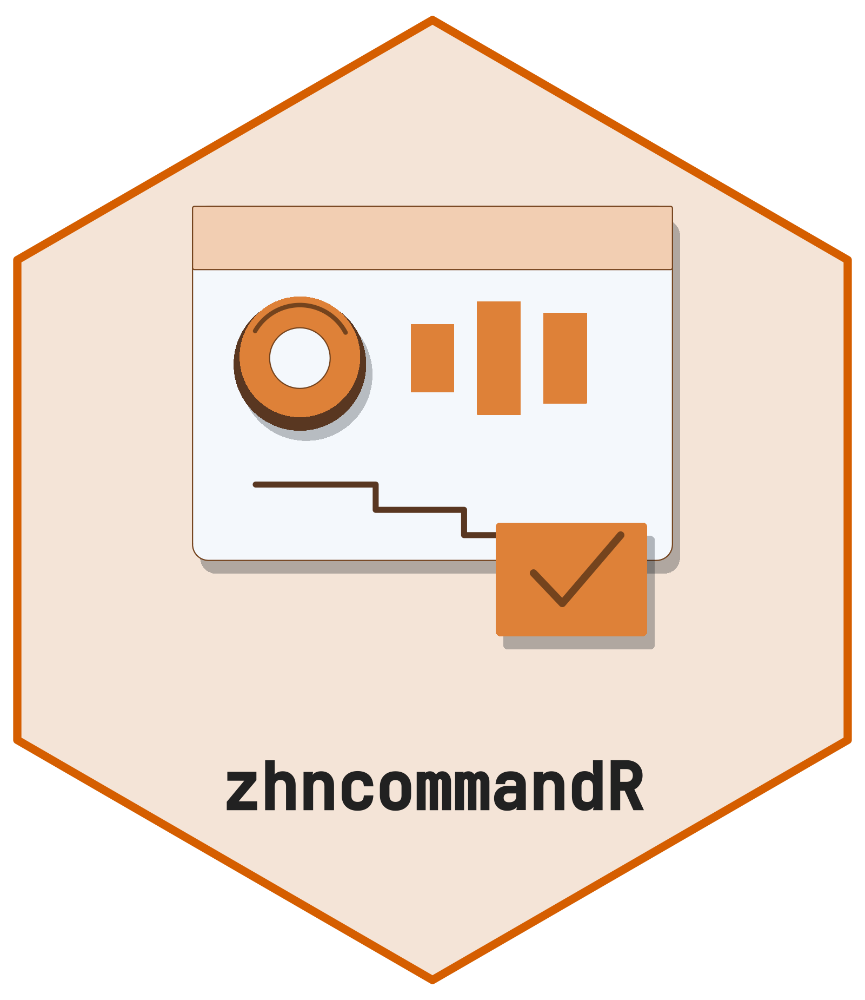

<!-- README.md is generated from README.Rmd. Please edit that file. -->

```{r, include = FALSE}
knitr::opts_chunk$set(
  collapse = TRUE,
  comment = "#>",
  fig.path = "man/figures/README-",
  out.width = "100%"
)
```

# zhncommandR <a href="https://cttir.github.io/zhncommandR/"></a>

<!-- badges: start -->
[](https://github.com/CTTIR/zhncommandR/actions/workflows/R-CMD-check.yaml)
[](https://cttir.github.io/zhncommandR/)
[](https://CRAN.R-project.org/package=zhncommandR)
[](https://app.codecov.io/gh/CTTIR/zhncommandR?branch=main)
[](https://cran.r-project.org/package=zhncommandR)
[](https://cran.r-project.org/package=zhncommandR)
[](https://opensource.org/licenses/MIT)
[](https://lifecycle.r-lib.org/articles/stages.html#experimental)
<!-- badges: end -->

`zhncommandR` is an **auditor live-evaluation dashboard** for haematological
tumour centres. It reads the tumour-documentation Excel sheets that auditors
work with day to day, and turns them into a single interactive view of cohort
quality, OPS-coded complex chemotherapy and diagnostics, survival, and
molecular profiles. The package is part of the **CTTIR** suite and shares
the [themakR](https://github.com/CTTIR/themakR) visual identity.

## What you get

- **Auditor dashboard.** Patient counts, primary-case / patient-case flags,
  Psychoonkologie / Sozialdienst / HIV-Hepatitis screening coverage.
- **Simple queries.** Pre-baked auditor questions ("HL 2025?",
  "Multiples Myelom?", "documented psycho-oncology?") plus a custom-column
  builder.
- **OPS-8-544 complex chemotherapy.** Block counts per protocol, per
  diagnosis, monthly trend, full block-detail table.
- **OPS-1-941 complex diagnostics.** Counts per component (Morphologie,
  Immunphänotypisierung, Zytogenetik, Molekulargenetik) and per diagnosis.
- **Kaplan-Meier.** PFS / OS with auto event detection, stratification,
  diagnose-specific filter. Uses `survminer` when present, base ggplot otherwise.
- **Oncoprint.** Tile plot of true mutations/variants split by entity, with
  structural and cytogenetic findings reported separately.
- **Zytogenetik.** Dedicated view for karyotypic findings (`del(17p)`,
  `t(11;14)`, `Trisomie 12`, complex karyotype, …).
- **Tumour-board decisions.** Capture, review, download / re-upload — all
  in-session, never written to disk by the app.

A **fully synthetic example cohort** (`inst/extdata/zhn_example.xlsx`) is
bundled, so you can explore everything without any real patient data.
Real data is never committed.

## Installation

```r
# install.packages("pak")
pak::pak("CTTIR/zhncommandR")
```

## Quick start

```r
library(zhncommandR)

# Programmatic — readers + parsers
path   <- zhn_example_path()
cohort <- zhn_read_cohort(path)
nrow(cohort)

onco <- zhn_parse_oncoprint(cohort)
head(onco[, c("patient_label", "diagnose_label", "alteration")])

# Interactive dashboard
zhn_run_app()
```

In the running app, click **Beispieldaten laden** to load the bundled
synthetic cohort, or use the **Kohorten-Excel (.xlsx) hochladen** control
to upload your own tumour-documentation workbook. The dashboard accepts
the canonical sheets `Basisdaten`, `Komplexe Chemotherapie`, and
`Komplexe Diagnostik` (with regex fallbacks).

## Public API

```{r api-table, echo = FALSE, results = "asis"}
# Auto-generated from NAMESPACE so this stays in sync with the package.
ns <- readLines("NAMESPACE")
exports <- sub("^export\\(([^)]+)\\)$", "\\1",
               grep("^export\\(", ns, value = TRUE))
descriptions <- c(
  zhn_run_app                    = "Launch the Shiny dashboard",
  zhn_example_path               = "Path to the bundled synthetic workbook",
  zhn_read_cohort                = "Read the Basisdaten sheet",
  zhn_read_therapy               = "Read the OPS-8-544 complex-chemotherapy sheet",
  zhn_read_diagnostics           = "Read the OPS-1-941 complex-diagnostics sheet",
  zhn_read_tumorboard            = "Load a previously exported tumour-board CSV",
  zhn_prepare_therapy_blocks     = "Per-block S3 object for OPS-8-544",
  zhn_prepare_diagnostic_blocks  = "Per-case S3 object for OPS-1-941",
  zhn_parse_oncoprint            = "Split + classify the mutation free-text column",
  zhn_parse_cytogenetics         = "Split + classify the cytogenetics column",
  zhn_normalize_alteration       = "Strip Mutation/Mut suffix, collapse whitespace",
  zhn_alteration_type            = "Classify a free-text alteration string",
  zhn_is_mutation                = "Predicate: belongs in the oncoprint?",
  new_cohort_df                  = "S3 constructor for the cohort wrapper",
  new_therapy_blocks             = "S3 constructor for the therapy-block wrapper",
  new_diagnostic_blocks          = "S3 constructor for the diagnostic-block wrapper"
)
df <- data.frame(
  Function = paste0("`", exports, "()`"),
  Purpose  = unname(descriptions[exports]),
  stringsAsFactors = FALSE
)
knitr::kable(df, format = "markdown")
```

See the [reference index](https://cttir.github.io/zhncommandR/reference/) for
parameter and return-type contracts.

## Authors

- **Hanno Witte** *(aut)*
- **Raban Heller** *(aut, cre)* —
  ORCID [0000-0001-8006-9742](https://orcid.org/0000-0001-8006-9742)

## License

MIT.
