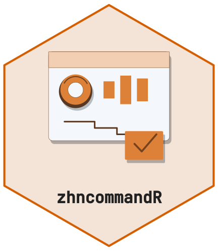

<!-- badges: start -->
[](https://github.com/CTTIR/zhncommandR/actions/workflows/R-CMD-check.yaml)
[](https://cttir.github.io/zhncommandR/)
[](https://CRAN.R-project.org/package=zhncommandR)
[](https://app.codecov.io/gh/CTTIR/zhncommandR?branch=main)
[](https://cran.r-project.org/package=zhncommandR)
[](https://cran.r-project.org/package=zhncommandR)
[](https://opensource.org/licenses/MIT)
[](https://lifecycle.r-lib.org/articles/stages.html#experimental)
<!-- badges: end -->

```{r setup, include = FALSE}
knitr::opts_chunk$set(
  collapse = TRUE,
  comment = "#>",
  fig.width = 7, fig.height = 4.5
)
library(zhncommandR)
```

<p style="text-align:center; margin: 1.5rem 0;">
  
</p>

`zhncommandR` packages the **ZHN Auditor** dashboard — a Shiny app for live
evaluation of haematological tumour-centre cohorts — together with the
backend helpers that drive it. The dashboard is launched with
`zhn_run_app()`. The rest of this vignette shows the same analyses run
programmatically against the bundled synthetic example.

This package ships three vignettes:

- **Getting started** (this one) — readers, parsers and a first survival curve.
- **Figures and tables** — the publication-ready figures and the tables behind
  every dashboard panel, run programmatically.
- **The Shiny dashboard** — a guided tour of the interactive auditor app.

## Example data

The package ships a 100 % synthetic example workbook with three sheets:
`Basisdaten`, `Komplexe Chemotherapie`, `Komplexe Diagnostik`.

```{r}
path <- zhn_example_path()
basename(path)
```

## Reading the cohort

```{r}
cohort <- zhn_read_cohort(path, verbose = FALSE)
cohort |>
  dplyr::select(dplyr::any_of(c(
    "name", "diagnose", "behandlungsjahr", "primaerfall",
    "psychoonkologie", "pfs", "os"
  ))) |>
  dplyr::glimpse()
```

`zhn_read_cohort()` calls `janitor::clean_names()`, drops empty `none*`
columns, and derives `behandlungsjahr` from the first matching date column.

## Quality indicators

The indicator table on the dashboard is just a `dplyr` summary of a fixed
indicator list:

```{r}
indicators <- c("tumorkonferenz", "psychoonkologie", "sozialdienst",
                "hiv_hepatitis")

cohort |>
  dplyr::select(dplyr::any_of(indicators)) |>
  tidyr::pivot_longer(
    dplyr::everything(),
    names_to = "Indikator", values_to = "Wert"
  ) |>
  dplyr::group_by(Indikator) |>
  dplyr::summarise(
    Positiv = sum(zhncommandR:::.as_yesno(Wert) %in% TRUE, na.rm = TRUE),
    Gesamt  = dplyr::n(),
    Anteil  = round(Positiv / Gesamt, 2),
    .groups = "drop"
  )
```

## OPS-8-544 therapy blocks

```{r}
therapy_raw <- zhn_read_therapy(path, verbose = FALSE)
blocks <- zhn_prepare_therapy_blocks(therapy_raw)
blocks |>
  dplyr::select(patient, therapieprotokoll, diagnose, datum) |>
  dplyr::slice_head(n = 6)
nrow(blocks)
```

## Kaplan-Meier — publication-ready

`zhn_plot_km()` builds a publication-ready survival figure with
[ggsurvfit](https://www.danieldsjoberg.com/ggsurvfit/); every element (CI, risk
table, censor marks, log-rank p, Cox HR, median, pairwise comparisons, axis and
legend) is an argument and is honoured in the PNG/PDF export. A single overall
curve with confidence interval, censor marks and a numbers-at-risk table:

```{r km-default, eval = requireNamespace("ggsurvfit", quietly = TRUE), message = FALSE, warning = FALSE, fig.height = 6}
zhn_plot_km(cohort, time_col = "os", event_col = "death_event",
            title = "Gesamtüberleben (synthetisch)")
```

Stratified by entity, with the log-rank p-value and the median-survival
reference lines:

```{r km-grouped, eval = requireNamespace("ggsurvfit", quietly = TRUE), message = FALSE, warning = FALSE, fig.height = 6}
zhn_plot_km(cohort, time_col = "os", event_col = "death_event",
            group_col = "geschlecht", show_pvalue = TRUE, show_median = TRUE,
            title = "Gesamtüberleben nach Geschlecht")
```

For a two-group comparison, `show_hr = TRUE` adds the Cox hazard ratio with its
95% CI. The hazard ratio always ships with a `survival::cox.zph()`
proportional-hazards check: when the assumption looks violated, a caution note
is added to the caption rather than reporting the HR silently.

## Oncoprint table

```{r}
onco <- zhn_parse_oncoprint(cohort)
onco |>
  dplyr::select(patient_label, diagnose_label, alteration, alteration_class) |>
  dplyr::slice_head(n = 6)
```

## Launching the dashboard

```r
zhn_run_app()
```
